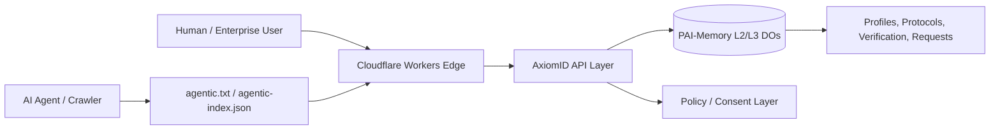

# PAI-Memory Deployment Plan | خطة PAI-Memory

This repository is prepared for an agentic-services deployment path where:

- **Cloudflare Workers** is the edge hosting target for the AxiomID/OpenIdentity frontend and discovery files.
- **PAI-Memory** is the 7-layer agent memory layer (D1 + Durable Objects) for profile indexing, discovery metadata, access requests, pilot workspaces, and audit/event storage.

> Note: Deployment uses the openidentity-md Cloudflare Worker with `frontend/` assets. PAI-Memory provides persistent, verifiable, shared agent memory.

## Service Architecture



## Recommended Responsibilities

| Layer | Service | Responsibility |
|---|---|---|
| Frontend hosting | Cloudflare Workers | Static AxiomID landing page, bilingual UI, docs links, discovery files |
| Agent memory | PAI-Memory | 7-layer D1/DO-backed storage for profiles, discovery index, access requests, audit events |
| Discovery files | Repo + hosted frontend | `agentic.txt`, `agentic.md`, `agentic-index.json`, optional `llms.txt` |
| CI/CD | GitHub Actions | Validate JSON, build indexes, smoke-test frontend |
| Fallback hosting | Vercel | Optional fallback if Workers deployment is unavailable |

## PAI-Memory Data Model for MVP

```sql
-- D1 schema mirrors (PAI-Memory uses D1 + Durable Objects)
create table if not exists profiles (
  id text primary key,
  display_name text not null,
  controller_type text not null,
  manifest_url text not null,
  verification_state text not null default 'self-attested',
  languages text not null default '["en"]',
  protocols text not null default '[]',
  created_at text not null default (datetime('now')),
  updated_at text not null default (datetime('now'))
);

create table if not exists access_requests (
  id text primary key,
  profile_id text,
  requester_email text not null,
  requested_resource text not null,
  consent_marketing integer not null default 0,
  status text not null default 'pending',
  created_at text not null default (datetime('now'))
);

create table if not exists discovery_events (
  id text primary key,
  profile_id text,
  event_type text not null,
  source text,
  metadata text not null default '{}',
  created_at text not null default (datetime('now'))
);
```

## Environment Variables

Use `.env.example` as the canonical local/CI reference.

| Variable | Purpose |
|---|---|
| `CF_API_TOKEN` | Cloudflare API token for Workers/D1 deployment |
| `CF_ACCOUNT_ID` | Cloudflare account ID |
| `PAI_MEMORY_L2_DO` | PAI-Memory L2 Durable Object binding |
| `PAI_MEMORY_L3_DO` | PAI-Memory L3 Durable Object binding |
| `D1_DATABASE_ID` | PAI-Memory D1 database ID |
| `AXIOMID_PUBLIC_URL` | Public canonical URL for the AxiomID frontend |

## Deployment Flow

1. Build the machine-readable discovery index:

```bash
python3 scripts/build_agentic_index.py
```

2. Run local validation:

```bash
npm run check
```

3. Deploy to Cloudflare Workers:

```bash
npx wrangler deploy --name openidentity-md --assets=frontend --compatibility-date 2026-08-05
```

4. Apply PAI-Memory D1 migrations:

```bash
npx wrangler d1 execute pai-memory --file=./scripts/providers/pai_memory_schema.sql
```

5. Confirm the live URL and set `AXIOMID_PUBLIC_URL` in CI and repository settings.

## Agentic Discovery Requirements

The hosted frontend should expose these public files at stable URLs:

- `/agentic.txt`
- `/agentic.md`
- `/agentic-index.json`
- `/openidentity.md` when a concrete profile is hosted
- `/llms.txt` if a curated LLM crawler index is added

## Arabic Summary | ملخص عربي

تم تجهيز المستودع لمسار نشر يعتمد على **Cloudflare Workers** للاستضافة و **PAI-Memory** كطبقة ذاكرة وكلاء من 7 طبقات (D1 + Durable Objects). يستخدم Workers لاستضافة الواجهة وملفات الاكتشاف، ويستخدم PAI-Memory لتخزين ملفات الهوية، حالات التحقق، طلبات الوصول، وأحداث الفهرسة مع احترام الخصوصية والموافقة.